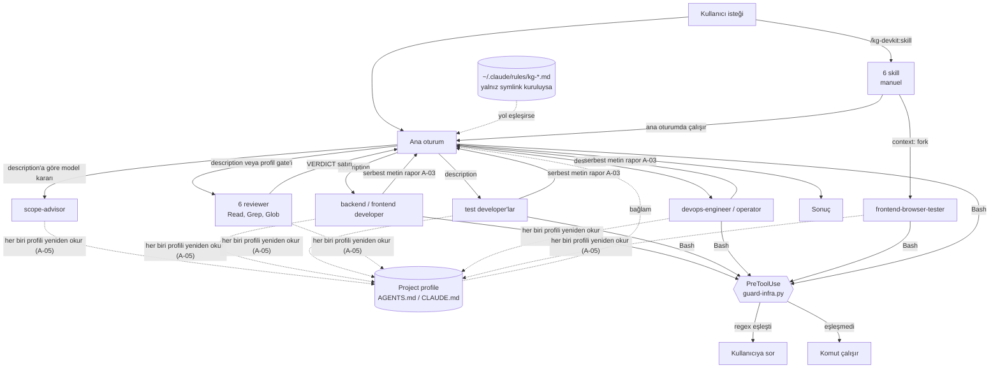
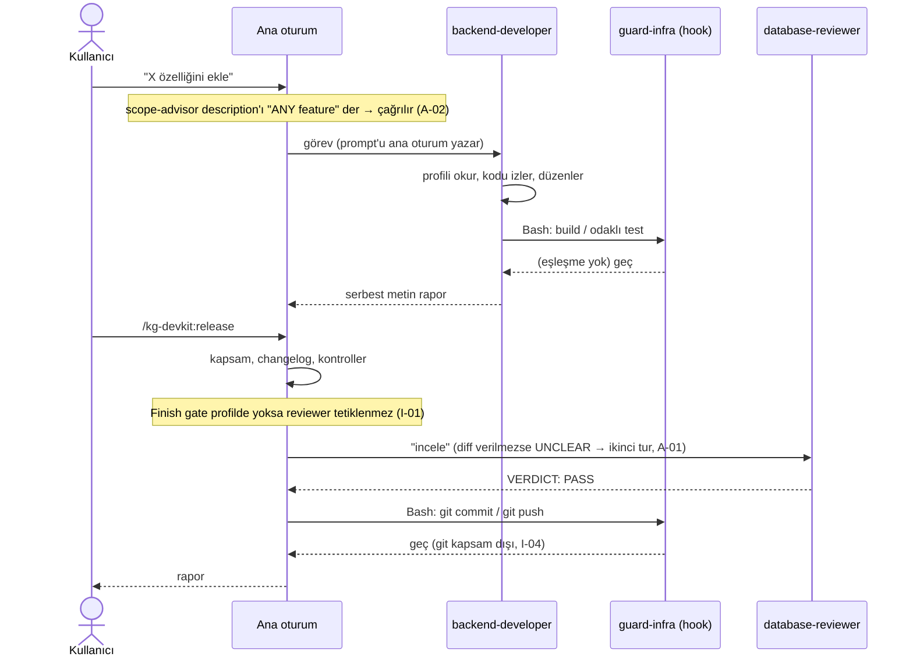
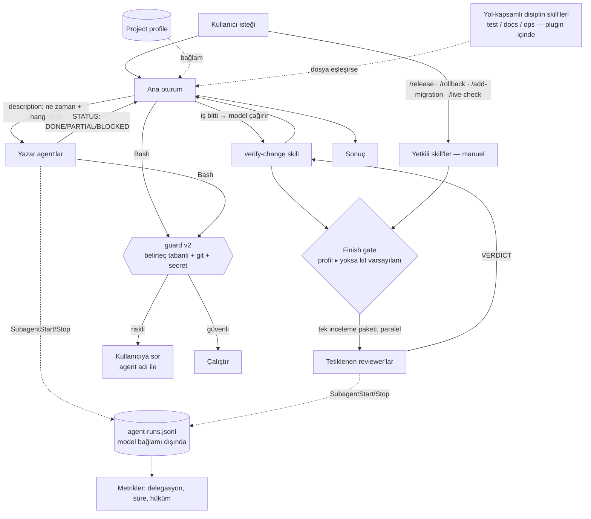

# 05 — Entegrasyon analizi

> **Durum notu:** Bu rapor `6b14d73` (v0.8.9) commit'indeki durumu anlatır; dosya yolu ve satır numaraları o commit'e
> göredir, bağlantılar dosyaların güncel hâline gider. Bulguların uygulama durumu ve canlı deney sonuçları:
> [13-implementation-status.md](13-implementation-status.md).

Bileşenler tek sistem olarak ele alınır. Akışlar dosya içeriklerinden ve resmi dokümandaki olay modelinden türetildi;
canlı oturumda izlenmedi.

## 1. Kullanıcı bir görev verdiğinde ne devreye giriyor?

Kit'te yönlendirici (router) bileşen yoktur. Karar noktaları:

1. **Ana oturum** isteği okur. Bağlamında: projenin `CLAUDE.md`/`AGENTS.md`'si (içinde `Project profile`), kuruluysa
   yol-eşleşen `~/.claude/rules/kg-*.md`, ve 15 agent'ın `description` satırı (~1.080 token, ölçüm).
2. **Agent seçimi** yalnız bu `description` metinlerine göre modelin kararıdır. Kit'in hiçbir dosyası "şu tür değişiklikte
   şu agent" eşlemesi içermez; eşleme tüketici profilinin `Finish gate` alanına bırakılmıştır
   (`docs/project-profile-template.md:29`).
3. **Skill'ler** yalnız kullanıcı `/kg-devkit:<ad>` yazınca yüklenir (6/6 `disable-model-invocation`).
4. **Kanca** her Bash çağrısından önce (ana oturum ve alt-agent) çalışır.
5. **Doğrulama** yazar agent'ın kendi build/test'i, reviewer `VERDICT`'i ve skill adımlarıyla yapılır; hiçbirini
   deterministik olarak zorlayan bir mekanizma yoktur (plugin'de `Stop`/`SubagentStop` kancası yok).

## 2. Mevcut mimari

## 3. On soruya cevaplar

| # | Soru | Cevap | Bulgu |
| --- | --- | --- | --- |
| 1 | Hangi mekanizma devreye giriyor? | Ana oturumun model kararı; kit yalnız `description` ve (kuruluysa) kural sağlar | — |
| 2 | Doğru agent nasıl belirleniyor? | `description` eşleşmesi. Olumsuz kapsam cümleleri ("not for …") iyi; gerekli girdi ve tetik koşulu eksik | A-01, A-02 |
| 3 | Agent hangi skill'leri kullanıyor? | **Hiçbirini.** Skill'ler manuel ve alt-agent'lara yüklenmez; agent ↔ skill bağı yalnız `browser-test → frontend-browser-tester` (skill agent'ı çalıştırır) | S-02 |
| 4 | Skill kullanımı neye bağlı? | Kullanıcının komutu yazmasına | S-02 |
| 5 | Hook hangi aşamada? | Her Bash çağrısından hemen önce; diğer araçlar (Edit, Write, MCP) görünmez | H-01…H-07 |
| 6 | Gereksiz tekrar var mı? | Var: profil okuma talimatı ×15, `Logging` ×15, `Hard limits` ×7, legacy-Release paragrafı ×3, reviewer-bloklama ×3, hedef çözümleme ×3; kurallar ↔ agent gövdeleri | A-05, A-06, S-03 |
| 7 | Çelişki var mı? | §4 | — |
| 8 | Hata olunca nasıl toparlanıyor? | Reviewer `UNCLEAR/FAIL` → skill "blocked" raporlar ✔. Yazar agent hatası serbest metinde kalır. Kanca hatası fail-open. Kısmi rollback "dur ve raporla" ✔ | A-03, H-05 |
| 9 | Farklı yoldan başlatınca tutarlı mı? | Hayır, §5 | I-01 |
| 10 | Sorumluluk sınırları doğru mu? | Büyük ölçüde: agent = rol ve denetim listesi, skill = yetkili iş akışı, hook = deterministik fren. Eksik olan: "hangi değişiklik hangi reviewer'ı gerektirir" bilgisi kit'in hiçbir yerinde değil | I-01 |

## 4. Kurallar arası çelişkiler ve boşluklar

| Konu | Kaynak A | Kaynak B | Etki |
| --- | --- | --- | --- |
| Secret okuma | `rules/kg-ops-safety.md:15` "Do not run `get secret -o yaml/json`" (koşulsuz) | `devops-operator.md:22-23` secret store'u "only to use a value inside a script" okuyabilir | Kural yüklüyse operator'ın izinli işi kuralla çelişir. Kural "operator dışında" diye sınırlandırılmalı |
| Salt-okuma serbestliği | `kg-ops-safety.md:18` "Read-only inspection is free"; `devops-engineer.md:19-21` | Kanca `gcloud run … describe`, `--dry-run`, `--help` komutlarını sorar | H-03 |
| Kancaya güven | `live-check:20-21` "the plugin's guard hook inspects the literal command text" | Kanca çok satırlı ve bayrak-önce biçimleri kaçırır | H-01: metin, kancanın sağlamadığı bir garantiyi ima ediyor |
| Ana oturuma talimat | `scope-advisor.md:44-46` "The main session MUST …" | Ana oturum agent gövdesini görmez | A-02 |
| Girdi beklentisi | 6 reviewer gövdesi "main session supplies the diff" | `description` satırları girdiden söz etmez | A-01 |
| Test koşma/yazma | `backend-developer.md:16-17` test düzenleyemez | aynı dosya :27-28 odaklı testleri koşar | A-03: yeni davranışın testi yokken "geçti" anlamı zayıf |
| Model katmanı (bilgi) | README:46-47 beş `opus` agent | Codex çıktısı model taşımaz (`build-codex.py`) | Belgelenmiş sınır; Codex'te tüm agent'lar oturum modelinde |

## 5. Aynı işin farklı yollarla başlatılması (I-01)

"Bir şema değişikliğini bitir" görevi için:

| Yol | Reviewer tetiklenir mi? | Dayanak |
| --- | --- | --- |
| Kullanıcı `/kg-devkit:add-migration` | Gate varsa evet; yoksa "must be clarified" → sorar | add-migration:36-39 |
| Kullanıcı `/kg-devkit:release` | Gate varsa evet; **yoksa tanımsız** ("Resolve uncertain triggers against the gate") | release:41-44 |
| Kullanıcı `/kg-devkit:verify-change` | Gate varsa evet; yoksa değinilmez | verify-change:27-29 |
| Kullanıcı düz metinle ister, skill yok | Yalnız model `database-reviewer` description'ını ilgili bulursa | agents/database-reviewer.md:3 |
| Codex | Aynı metinler; kanca yok | codex/ |

Kök neden: reviewer tetikleme bilgisi tümüyle tüketici profilindedir ve varsayılanı yoktur. Altı reviewer'ın değeri,
profil yazarının `Finish gate` alanını doğru doldurmasına bağlıdır.
**Çözüm:** kit'te bir **varsayılan gate tablosu** ([örnek](../../plugins/kg-devkit/references/finish-gate-default.md)); üç skill aynı
cümleyle ona düşer; profil gate'i her zaman önceliklidir.

## 6. Hata ve toparlanma

| Hata | Bugünkü davranış | Boşluk |
| --- | --- | --- |
| Reviewer çalıştırılmadı ama "PASS" raporlandı | Skill metni "do not invent a passing verdict" der | Doğrulayan mekanizma yok (**I-03**, P2). `agent-runs.jsonl` kaydı ([örnek](../../plugins/kg-devkit/hooks/agent_run_log.py)) en azından sonradan denetlenebilir kanıt verir |
| Yazar agent build'i kıramadan döndü | Rapor metninde | A-03 |
| Kanca çöktü / Python yok | İşlem devam eder | H-05, H-06 |
| Uzun görevde bağlam sıkışması | Kit'in durumu dosyada tutan bir mekanizması yok; alt-agent'lar izole bağlam sağlar ✔ | Skill adımlarının ortasında sıkışma olursa hangi adımda kalındığı kaybolabilir; `release` için risk düşük (kısa), `rollback` için "plan ve onay" adımı yeniden doğrulanmalı — skill bunu zaten "approval in the current conversation" ile sınırlar ✔ |
| İki agent aynı dosyayı değiştirdi | Dizin sahipliği metinle önler | Ortak dosyalar (üretilen tipler, changelog) sahipsiz → paralelde ana oturuma bırak |

## 7. Hedef mimari (Dengeli — [12](12-architecture-proposals.md) seçenek B)

Yeni agent yok. Değişen: (a) çağıranın göreceği sözleşmeler, (b) varsayılan gate, (c) kancanın kapsamı,
(d) deterministik kayıt.

Gerçek olay sırası "Agent → Skill → Tool → Hook → Validation" değildir ve hedefte de öyle olmayacaktır:
skill'ler agent'ları çağırır (tersi değil), kanca her araç çağrısında araya girer, doğrulama hem yazar agent içinde
(build/test) hem de skill düzeyinde (gate) iki ayrı yerde gerçekleşir.
