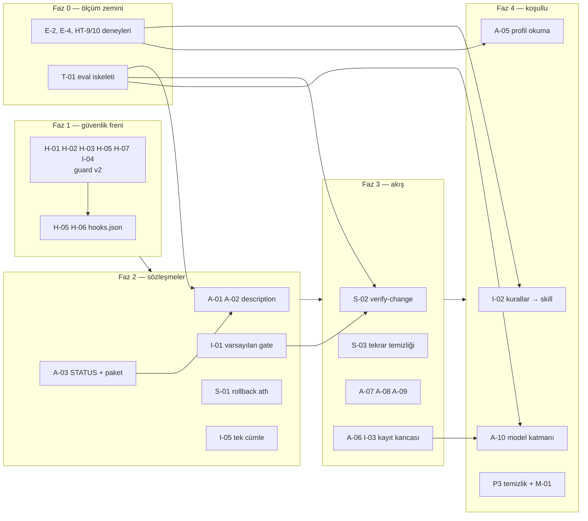

# 10 — Önceliklendirilmiş iyileştirme planı

> **Durum notu:** Bu rapor `6b14d73` (v0.8.9) commit'indeki durumu anlatır; dosya yolu ve satır numaraları o commit'e
> göredir, bağlantılar dosyaların güncel hâline gider. Bulguların uygulama durumu ve canlı deney sonuçları:
> [13-implementation-status.md](13-implementation-status.md).

Bu dosya bulgu ID'lerinin **tek kaynağıdır**; diğer raporlar buraya atıf yapar. Yollar plugin köküne göredir
(`plugins/kg-devkit/`), `↑` ile başlayanlar repo köküne göredir.

Kanıt türü: **Ö** = bu analizde ölçüldü/çalıştırıldı, **K** = dosya içeriğinden okunur, **D** = resmi dokümana dayalı
çıkarım (canlıda sınanmadı).

## 1. Bulgu tablosu

| ID | Öncelik | Bileşen | Sorun | Kanıt | Çözüm | Beklenen etki |
| --- | --- | --- | --- | --- | --- | --- |
| H-01 | P0 (koşullu) | `hooks/guard-infra.py:19-26` | Fiilden önce bayrak, satır devamı ve alt komut biçimleri kancayı atlar (`helm -n prod uninstall`, `terraform -chdir=… destroy`, `docker --context prod compose up`, çok satırlı `kubectl`) | **Ö**: 25 senaryodan 3'ü yakalandı | Belirteç tabanlı ayrıştırıcı ([prototip](../../plugins/kg-devkit/hooks/guard-infra.py)) | Kit'in tek deterministik freni yaygın biçimleri görür |
| H-02 | P1 | `guard-infra.py:17,20,26` | Bulut/`vault`/`sops` secret okuma ve `stop/deploy/sync/patch` fiilleri kapsanmıyor; `kubectl get -o yaml secret` sırası kaçıyor | **Ö**: 27/27 kaçtı | aynı prototip | Secret'ın bağlama girmesi öncesi onay |
| H-03 | P1 | `guard-infra.py:19,23,24,26` | Tırnaklı metin, bayrak değeri, `--help`, `--dry-run`, `gcloud run … describe`, yerel compose gereksiz sorulur | **Ö**: 36 zararsız senaryodan 24'ü soruldu | aynı prototip; `KG_GUARD_LOCAL_COMPOSE` | Onay yorgunluğu azalır |
| H-04 | P1 | `skills/browser-test/SKILL.md:7-8`, `agents/frontend-browser-tester.md:35` | Fork'lanan/arka plan agent'ta ve `bypassPermissions`/`dontAsk` modunda `ask` davranışı bilinmiyor | **D** (belirtilmemiş) | Canlı deney HT-9/HT-10; sonuca göre `background: false` veya belgeleme | Tarayıcı testi takılmaz |
| A-01 | P1 | 6 reviewer + architect, satır 3 ve 10-12 | Gerekli girdi (diff, dosya listesi, kanıt) gövdede; çağıran yalnız `description`'ı görür; reviewer'da `Bash` yok | **K** + **D** | Girdiyi `description`'a yaz; inceleme paketi ([N-2](09-recommendations.md)) | `UNCLEAR` turları ve tüm-dosya okumaları azalır |
| A-02 | P1 | `agents/scope-advisor.md:3,13-15,44-46` | "ANY feature/fix" tetiklemesi; tek müşterili repoda boş delegasyon; ana oturuma yönelik MUST agent gövdesinde | **K** + **D** | [Örnek](../../plugins/kg-devkit/agents/scope-advisor.md) | Daha az delegasyon; soru gerçekten sorulur |
| A-03 | P1 | 6 yazar agent, "Return …" paragrafları (örn. `backend-developer.md:26-29`) | Bitiş durumu/başarı ölçütü yok; developer test yazamaz ama "testler" koşar | **K** | `STATUS/CHECKS/NOT RUN` bloğu | Yanlış "tamamlandı" raporu ayırt edilir |
| S-01 | P1 | `skills/rollback/SKILL.md:19,47` ↔ `skills/live-check/SKILL.md:4` | `rollback`, modelin yükleyemeyeceği skill'in adımlarına atıf yapar | **K** + **D** | Atfı `${CLAUDE_PLUGIN_ROOT}/skills/live-check/SKILL.md` yoluna çevir | Rollback öncesi/sonrası kontroller gerçekten uygulanır |
| I-01 | P1 | `skills/release/SKILL.md:41-44`, `verify-change:27-29`, `add-migration:36-39`, `↑docs/project-profile-template.md:29` | Reviewer tetikleme yalnız profil gate'inde; varsayılan yok; gate yokken üç skill farklı davranır | **K** | Varsayılan gate dosyası ([N-1](09-recommendations.md)) | Aynı iş hangi yoldan başlarsa başlasın aynı reviewer'lar |
| I-02 | P1 | `↑rules/*.md`, `↑README.md:50-51` | Disiplin kuralları plugin ile gelmiyor; ana oturum varsayılan kurulumda kuralsız | **K** + **D** | Yol-kapsamlı skill denemesi (E-4) → [N-4](09-recommendations.md) | Tek adımlı kurulum tam davranışı verir |
| T-01 | P1 | `↑docs/inventory.md:82-84`, `↑.github/workflows/check.yml` | Davranış testi yok; skill'ler ve tarayıcı testçisi uçtan uca hiç çalıştırılmamış | **K** | `claude plugin eval` seti ([11](11-test-strategy.md)) | Regresyon ve seçim doğruluğu ölçülür |
| A-04 | P2 | `agents/devops-operator.md:5,13-15`, `devops-engineer.md:5` | Onay ana oturumdan aktarılır, doğrulanamaz; iki agent'ın araçları aynı | **K** | Kanca mesajına `agent_type`; kanca kapsamı (H-01/02) | Onayı gerçekten kullanıcı verir |
| A-05 | P2 | 15 agent, ~satır 10 | Profil muhtemelen hem bağlamda hem `Read` çıktısında | **D** | Deney E-2; "bağlamdaysa okuma" | Çağrı başına bir dosya okuması |
| A-06 | P2 | 15 agent satır 8; 7 agent son satır | 6.274 bayt (%12,5) tekrar; başlangıç satırı çağırana görünmez | **Ö** (bayt), **D** | Kayıt kancası ([N-3](09-recommendations.md)); sonra paragrafı kaldır | Deterministik iz + ölçüm verisi |
| A-07 | P2 | `agents/tenant-security-reviewer.md:2-3,19-31` | Enjeksiyon/XSS/gömülü secret sahipsiz; ad kiracısız projede seçimi zorlaştırır | **K** | Denetim maddesi + `description` | Güvenlik kapsamı genişler |
| A-08 | P2 | `agents/frontend-browser-tester.md:5,51-52` | Sınırsız `Bash`, `maxTurns` yok, tek tarayıcı arka ucu | **K** | `maxTurns`; yerleşik tarayıcı araçları için not | Döngü maliyeti sınırlanır |
| A-09 | P2 | `tenant-security-reviewer.md:26` ↔ `observability-reviewer.md:21-22`; `database-reviewer.md:29-30` ↔ `performance-reviewer.md:20-21`; `devops-engineer.md:3` ↔ `rollback`/`live-check` | Çakışan denetim maddeleri ve çift başlatma yolu | **K** | Yönlendirme cümleleri; `devops-engineer` açıklamasını daralt | Çift bulgu azalır |
| A-10 | P2 | 5 `opus` agent; `↑CHANGELOG.md` 0.8.1 | Model katmanı ölçüme dayanmıyor; `effort`/`maxTurns` kullanılmıyor | **K** | Deney E-5 | Maliyet/kalite dengesi kanıtlanır |
| S-02 | P2 | 6 skill, satır 4 | Modelin çağırabildiği skill yok; `verify-change` yan etkisiz olduğu halde manuel | **K** + **D** | [Örnek](../../plugins/kg-devkit/skills/verify-change/SKILL.md) | İş bitiminde doğrulama kendiliğinden başlar |
| S-03 | P2 | `release:18`, `rollback:15`, `live-check:12`; `release:43`, `verify-change:28-29`, `add-migration:38-39`; `browser-test:18-22` ↔ `frontend-browser-tester.md:18-21` | Aynı paragraflar 3 yerde; `browser-test` agent kurallarını tekrarlar | **K** | Ortak referanslar; tekrarı sil | Sapma riski azalır |
| H-05 | P2 | `guard-infra.py:42`, `hooks/hooks.json:8-10` | Nesne olmayan JSON'da traceback/çıkış 1; `timeout` yok (varsayılan 600 sn); karesel regex | **Ö**: 40 KB → 2.992 ms, 100 KB → 20.842 ms | `isinstance` kontrolleri; `"timeout": 5`; doğrusal ayrıştırıcı | Gürültü ve en kötü durum sınırlanır |
| H-06 | P2 | `hooks/hooks.json:9` | `python3` yoksa koruma sessizce yok | **K** + **D** | `python3 … \|\| python …` ([örnek](../../plugins/kg-devkit/hooks/hooks.json)) | Windows'ta kanca çalışır (sınanmalı) |
| H-07 | P2 | `guard-infra.py:25` | Migration yalnız EF Core; `helmfile`/`pulumi`/`argocd`/`flux`/`ansible` yok | **Ö**: 12/12 kaçtı | prototip | "Projeden bağımsız" iddiasıyla uyum |
| I-03 | P2 | `skills/release/SKILL.md:41-44` | Reviewer'ın çalıştığını/hükmünü doğrulayan mekanizma yok | **K** | Kayıt kancasında `outcome`; (sonra) `SubagentStop` zorlaması | Denetlenebilir iz |
| I-04 | P2 | `guard-infra.py` (kapsam), `skills/release/SKILL.md:23-24` | `git reset --hard/clean -f/push --force` ve secret dosyası stage'leme yalnız metinle korunur | **Ö** (R-git 3/3 kaçtı) | Kancaya git grubu (prototipte var); secret-yolu stage kuralı (prototipte **yok**) | Kullanıcı işi ve secret'lar için ikinci kilit |
| I-05 | P2 | 6 skill giriş paragrafı; reviewer/danışman agent'lar | "Profil kuralı gevşetemez" cümlesi yalnız 7 agent'ta | **K** | Tek cümle ekle | Profil kaynaklı yetki genişletme kapanır |
| M-01 | P2 | `plugins/kg-devkit/analysis/`, `↑.claude/hooks/kit-review-gate.py:17-20` | Plugin dizinindeki her dosya kullanıcı önbelleğine kopyalanır; bu raporlar da. Bakım kancası `plugins/**`'ı kaynak sayar | **D** + **K** | Onaydan sonra raporları `↑docs/analysis/`'e taşı | Dağıtım temiz kalır |
| S-04 | P3 | `skills/live-check/SKILL.md:1-6` | Salt-okuma skill'inde araç kısıtı yok | **K** + **D** | `disallowed-tools: Edit, Write` (doğrula) | Küçük |
| S-05 | P3 | 6 skill satır 5 | `user-invocable: true` varsayılanla aynı | **K** + **D** | Sil | Kozmetik |
| M-02 | P3 | `.claude-plugin/plugin.json:1-8` | `license`, `repository`, `keywords` yok; ikon uyarısı | **Ö** (`validate` uyarısı) | Alanları ekle | Keşfedilebilirlik |
| D-01 | P3 | `↑SECURITY.md:12-13` ↔ `↑README.md:52-54` | Kanca kapsamı SECURITY.md'de eksik | **K** | Metni eşitle | Tutarlı doküman |
| D-02 | P3 | `↑scripts/build-codex.py:63` | `SKILL_NAMES` elle yazılmış; yeni skill betik düzenlemesi ister | **K** | Skill klasörlerinden türet | Bakım |
| D-03 | P3 | — | `plugin details` skill açıklamalarını "always-on" sayıyor; doküman tersini söylüyor | **Ö** ↔ **D** | Canlıda `/context` ile ölç | Doğru taban değeri |
| D-04 | P3 | `↑docs/project-profile-template.md:3` | `CLAUDE.md` ve `AGENTS.md` birlikteyse `AGENTS.md` varsayılan olarak okunmaz | **D** | Şablona `@AGENTS.md` notu | Profil ana oturumda görünür |
| T-02 | P3 | `↑docs/inventory.md:55-56` | Mekanik agent lint'i LLM agent'ı yapıyor ("CI betiği yerine agent yapar") | **K** | Mekanik kontrolleri (frontmatter, zorunlu cümleler) CI betiğine al; yargı kontrolleri agent'ta kalsın | Ucuz ve tekrarlanabilir |

Toplam: 1 P0, 10 P1, 16 P2, 8 P3 (35 bulgu).

## 2. Aşamalar ve bağımlılıklar

| Faz | İçerik | Bağımlılık | Kırıcı mı | Doğrulama |
| --- | --- | --- | --- | --- |
| 0 | Deneyler E-2, E-4, HT-9/10; 10-15 istemli eval iskeleti | — | Hayır | Deney sonuçları bu dosyaya not edilir |
| 1 | Kanca v2 + `hooks.json` | — (Faz 0'dan bağımsız başlatılabilir) | Davranış değişir: bazı komutlar artık sorulur, bazıları sorulmaz → CHANGELOG **Değişen**, `[minor]` | `test_guard_infra.py` + genişletilmiş liste CI'da |
| 2 | `description`'lar, iki referans dosyası, `STATUS`, S-01, I-05 | Eval iskeleti (önce/sonra) | Hayır (adlar aynı) | Eval: seçim doğruluğu, `UNCLEAR` sayısı; `build-codex.py --check` |
| 3 | `verify-change` model çağrısı, tekrar temizliği, reviewer kapsamları, kayıt kancası | Faz 2 (gate ve paket) | `verify-change` artık kendiliğinden çalışabilir → CHANGELOG | Eval + `agent-runs.jsonl` |
| 4 | Kurallar → skill (E-4 olumluysa), profil okuma (E-2), model katmanı (E-5), P3'ler, raporların taşınması | Faz 0 deneyleri, Faz 3 kaydı | Kurallar için geçiş dönemi | Deney karar kuralları ([07](07-performance-optimization.md) §4) |

Her fazda mevcut bakım akışı geçerlidir: `python3 scripts/build-codex.py`, `kit-agent-linter`, `kit-doc-sync`,
`kit-prompt-sync`, CHANGELOG. `Logging` paragrafı kaldırılırsa `kit-agent-linter` kontrol 2 ve
`docs/agent-requirements.md` "Ortak kurallar" bölümü aynı PR'da güncellenmelidir.

## 3. En az eforla en yüksek fayda (ilk PR adayları)

1. `hooks.json`: `"timeout": 5` (H-05) — tek satır.
2. `rollback/SKILL.md`: atıf yolu (S-01) — iki satır.
3. `scope-advisor.md`: `description` + rapor bloğu (A-02).
4. Altı reviewer `description`'ına girdi cümlesi (A-01).
5. Altı skill'e "profil kuralı gevşetemez" cümlesi (I-05).
6. Varsayılan gate dosyası ve üç skill'de tek cümlelik atıf (I-01).

Bunların hiçbiri yeni bileşen, bağımlılık veya ad değişikliği gerektirmez.
